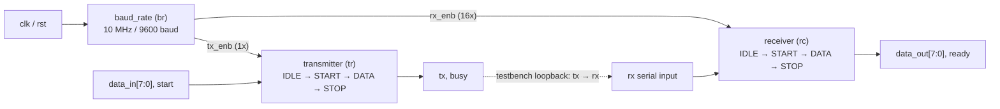
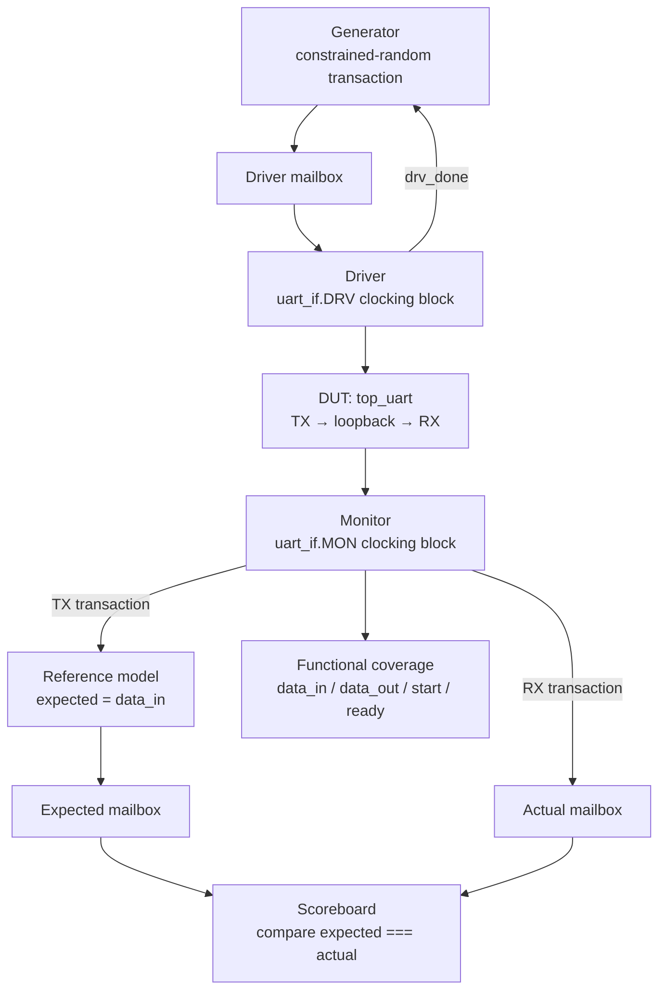

# UART Protocol — Verilog RTL & SystemVerilog Functional Verification

A UART **8-N-1** (8 data bits, no parity, one stop bit) implementation in Verilog, with a **non-UVM, class-based SystemVerilog** verification environment. The SV testbench wires the DUT's `tx` output back to its `rx` input to test serial loopback.

> **Verification status:** Updated code and diagrams are committed for review. The current SV simulation has **not been run or signed off**; no pass rate or coverage closure is claimed.

## RTL architecture



The top-level `top_uart` instantiates `baud_rate`, `transmitter`, and `receiver`. The design exposes separate serial `tx` and `rx` pins; **loopback exists in the testbench, not in the synthesizable top module**.

[Edit the RTL diagram in draw.io](doc/uart_rtl_architecture.drawio) · [Edit the verification diagram in draw.io](doc/uart_verification_architecture.drawio)

## Functional verification architecture



The testbench includes a transaction class, constrained-random generator, mailbox-based driver, monitor with separate transmit/receive tasks, reference model, scoreboard, environment, interface clocking blocks and functional covergroup. The scoreboard compares transmitted payloads against reconstructed receiver payloads.

### Coverage intent

- Directed bins for `8'h00`, `8'hFF`, `8'hAA`, `8'h55` plus data ranges
- TX-side `start`, RX-side `ready`, transmitted and received payload bins
- The testbench waits for 100% reported coverage or a simulation timeout; a timeout is **not** evidence of coverage closure.

## Source layout

```text
rtl/
  baud_gen.v       # new baud_rate module
  transmitter.v    # TX FSM
  receiver.v       # RX FSM
  top_uart.v       # new top_uart module
tb/
  tb_dut.sv        # SV interface/classes + tb_top
sim/
  questa.do        # simulator compilation and run script
doc/
  uart_rtl_architecture.drawio
  uart_verification_architecture.drawio
  ...              # existing images retained
```

> **Legacy compatibility:** This repo also retains earlier file(s) such as `rtl/baudrate_generator.v`, `rtl/uart_top.v`, and `tb/uart_top_tb.v` if present. They belong to the original Verilog-only version and may not have compatible interfaces with the newly supplied transmitter/receiver. **Do not compile all RTL files with a wildcard.** Use the explicit source list below for the updated SV design. The legacy testbench and older diagrams are retained for history, not as validation evidence for the new version.

## Running Questa/ModelSim

Use a simulator with support for SV **classes, mailboxes, constrained randomization, clocking blocks, and covergroups**. From the repository root:

```tcl
vlib work
vlog -sv rtl/baud_gen.v rtl/transmitter.v rtl/receiver.v rtl/top_uart.v tb/tb_dut.sv
vsim -c tb_top
run -all
quit -f
```

Alternatively run `do sim/questa.do` in the simulator console. If you run from another folder, adapt file paths.

- Default RTL baud configuration: `CLK_FREQ=10_000_000`, `BAUD=9600`
- SV testbench: `timescale 1ns/1ps` and `always #50 clk = ~clk` (10 MHz)
- Serial protocol: idle high, low start bit, eight payload bits LSB-first, high stop bit
- Scoreboard prints match/mismatch messages and an end-of-run pass/fail count
- Functional coverage percentages are only meaningful when observed in a supported simulator

## Current limitations and next steps

1. **No verified regression results yet.** Run the test and attach simulator transcript/waveform evidence before advertising a pass.
2. The SV testbench uses an **internal loopback**; external RX stimulus, parity, framing-error injection, and independent TX/RX clock variation are not implemented.
3. Scoreboard summary helps reporting, but formal completion criteria should also require enough compared transactions and appropriate coverage closure.
4. Module baud-frequency divisors are integer-truncated, and the RTL does not implement a parity bit.
5. The new files are **not UVM** and no assertions or coverage closure report are claimed.

## Editable diagrams

Open the two `.drawio` files in [diagrams.net](https://app.diagrams.net/). Modify and export PNG/SVG if needed. Earlier images in `doc/` were preserved unchanged.

## Project evolution

The repo originally included a Verilog-only UART demonstration and legacy images. This update adds a separately runnable class-based SystemVerilog verification environment while retaining the Git history and historical artifacts.
